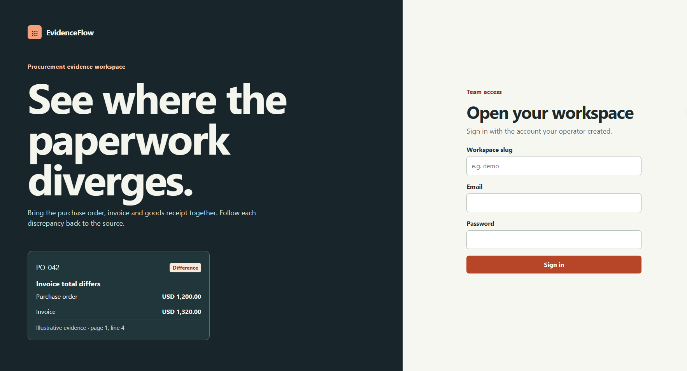

# EvidenceFlow

EvidenceFlow is a small-team procurement evidence workspace and an end-to-end Model Context Protocol practice project. Upload purchase orders, invoices and goods receipts. Review extracted differences against their source lines. Record a disposition only after a second person approves it.



**Start with the synthetic cases.** No Hugging Face account, token, or cloud service is needed for local use.

- [MCP practice lab](docs/LAB.md)
- [Architecture in Egyptian Arabic](docs/ARCHITECTURE.ar.md)
- [Threat model](docs/THREAT-MODEL.md)
- [Publishing guide](docs/DEPLOY.md)
- [Evaluation and portfolio walkthrough](docs/EVALUATION.md)

## Run locally with Docker Compose

Install Docker with Compose v2.24+ and start its engine. Extract the archive and open a terminal in the directory containing `compose.yaml`.

```sh
docker compose up --build --wait
docker compose exec app python -m app.cli bootstrap --workspace demo --email reviewer@example.test --name "Demo Reviewer"
docker compose exec app python -m app.cli member --workspace demo --email analyst@example.test --name "Demo Analyst"
docker compose exec app python -m app.cli seed --workspace demo --email analyst@example.test
```

Enter a different password of at least 12 characters for each account when prompted. Visit [localhost:8080](http://localhost:8080) and sign in as the analyst using workspace slug `demo`. The seed command can be rerun safely. The worker will finish extracting the files automatically.

1. Open **Northline compressor kits**. Expect an invoice total difference of USD 120 and 10 received against 12 ordered and invoiced. Open a source line or download the original.
2. Open **Harbor safety supplies**. Matching PO and invoice totals leave a missing goods receipt.
3. Choose **Run offline** and open **Activity** to see `mcp.tool.review_discrepancies`.
4. Submit **Request follow-up** in **Review**. Sign out and sign in as the reviewer to approve or reject it. A decision applies to the evidence revision recorded on the proposal.
5. Go to **MCP lab** to create a case-scoped token and connect the included Python client over Streamable HTTP.

`docker compose logs -f app` shows startup and worker errors. `docker compose down` stops the services and retains the local volumes. `docker compose up -d` starts them again. Keep port 8080 free, and use the exact origin `http://localhost:8080` for browser requests.

If port 8080 is reserved (Docker reports `ports are not available ... returned unexpected status: 500`), set `EVIDENCEFLOW_PORT=8765` in `.env` before starting Compose and open `http://localhost:8765`. The `bootstrap` and `member` commands reject passwords shorter than 12 characters, and `seed` fails with `Workspace member not found` until `member` has succeeded.

## Upload format

Select the document’s role explicitly. Supported inputs are UTF-8 TXT and unencrypted PDFs up to 5 MiB and 20 pages, including image-only scans. Supply these English labels on separate lines. Repeat `Item` for distinct SKU values. A goods receipt records quantities received and does not need a `Total` line.

```text
Supplier: Northline Industrial
PO Number: PO-042
Total: USD 1,200.00
Item: CMP-KIT | 12
```

Use `PO Number` or `PO Ref`. The extractor preserves exact trimmed lines with 1-based page and line indexes. PDF line numbers refer to the extracted text order. Numeric comparisons use decimals, and currency is compared separately. Repeated labels, duplicate SKUs and multiple documents of the same role surface gaps. Use the originals to investigate partial shipments, split invoices, tax or freight differences.

On PDF pages with images and no text layer, Poppler renders a page image and Tesseract produces an English transcription. Open **Inspect source page** on a citation to see the rendered page. Reviewers can correct recognized fields in that dialog or from **Documents**. A correction records who changed the value and why. The original transcription stays available, and prior proposals become stale because the evidence revision advances.

Try the scans in `examples/ocr/` in a fresh case alongside `examples/PO-042-po.txt`. Run the labeled [evaluation](docs/EVALUATION.md) with `docker compose exec -T app python -m app.evaluate --check`.

## Optional Hugging Face mode

Copy `.env.example` to `.env`. Configure a fine-grained `HF_TOKEN` with Inference Providers permission, set `HF_ALLOW_EVIDENCE=true`, and recreate the app with `docker compose up -d --force-recreate app`. `HF_MODEL` defaults to `openai/gpt-oss-120b:fastest`. Model and provider capabilities may change. Pick a provider that supports named tool choice and function calls if routing returns an error. Each HF run requires a checkbox confirmation in the browser. The selected provider receives your question and excerpts from up to 20 findings. Run this first with synthetic data. [HF function-calling documentation](https://huggingface.co/docs/inference-providers/guides/function-calling)

## Native development and tests

Use Python 3.12 and [uv](https://docs.astral.sh/uv/). Set `DATABASE_URL` to a dedicated local Postgres database in `.env` and keep `APP_ORIGIN=http://localhost:8080`. Run the same provisioning commands above with `uv run --locked python -m app.cli` in place of `docker compose exec app python -m app.cli`. The app applies the versioned SQL migration at startup.

```sh
uv sync --locked
uv run --locked python -m app.serve
```

Set `TEST_DATABASE_URL` to a separate, disposable Postgres database before running tests. The integration fixtures create test rows. Bash uses `export TEST_DATABASE_URL=...` and PowerShell uses `$env:TEST_DATABASE_URL = '...'`.

```sh
uv run --locked ruff check app tests
uv run --locked ruff format --check app tests
uv run --locked python -m pytest -q
node --check web/app.js
docker compose config --quiet
```

Without `TEST_DATABASE_URL`, pytest skips the integration suite. CI starts its own Postgres, runs the suite and lints, builds the image and audits the locked runtime dependencies.

For native OCR, page previews and the full benchmark, install `pdftoppm` (Poppler), `tesseract` and its English language data, then put both commands on `PATH`. The Docker image includes them.

## Verification for this release

- See the [benchmark baseline](docs/EVALUATION-RESULTS.md) for measured OCR, extraction and source citation results. The regression suite covers tenant boundaries, approval revisions, queue lease recovery and MCP transports.
- The HF Router and S3 adapter are tested with simulated responses. The hosting guide covers a first cloud deployment.

## Where to read the code

| Path | Responsibility |
| --- | --- |
| `web/`, `app/web.py` | Responsive same-origin UI, cookie authentication and REST endpoints |
| `app/service.py`, `migrations/` | Tenant scoping, revision checks, persistence and audit events |
| `app/worker.py`, `app/extract.py`, `app/rules.py` | Durable extraction queue, line-level provenance and deterministic comparison |
| `app/mcp_server.py`, `app/cli.py` | Official SDK Tools, Resources, Prompts and local/remote clients |
| `app/assistant.py` | MCP client, bounded HF tool loop and citation validation |
| `app/storage.py` | Local and S3-compatible object stores |
| `app/evaluate.py`, `examples/evaluation.json` | Reproducible benchmark and synthetic gold labels |

This MVP supports controlled pilots and training. Extraction targets the field labels listed above. Scans with embedded text use that text layer, and corrections apply to recognized fields. EvidenceFlow records internal review dispositions. ERP integration, line-price and tax reconciliation, OIDC and immutable audit storage are outside the pilot scope. The original teaching archive was unavailable in this workspace. EvidenceFlow recreates the documented CLI architecture in a new codebase.
